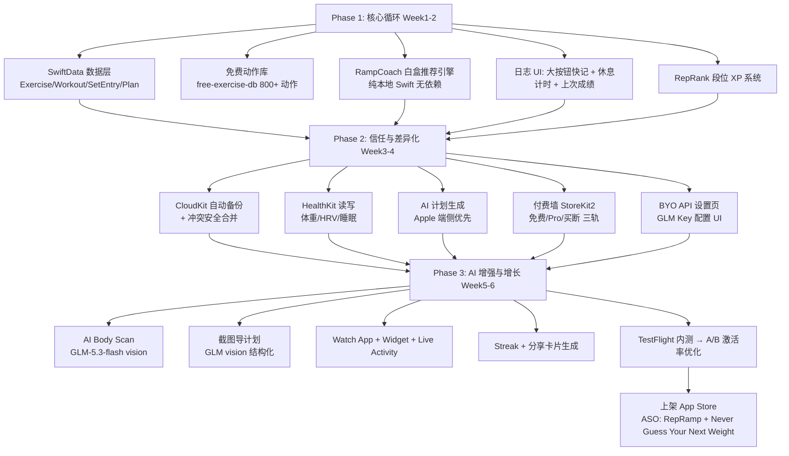
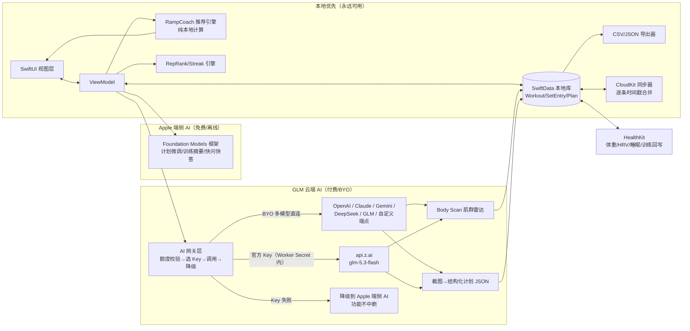

# TR-20260930-RepRamp健身追踪-操作指南

> **本文档目标**：任何 LLM / 开发者读完本文档后，可以从零复刻出一款在功能、UI、易用性和价格策略上全面碾压 Symmetry（美国英语市场）的 iOS 健身追踪 App。
> **复刻对象**：Symmetry: AI Gym Workout Log（西语市场，$160K+/月，300万下载，App Store 美区 4.8 分）
> **市场定位**：🇺🇸 美国英语市场，力量训练 / 健美 / 力量举人群
> **文档日期**：2026-09-30

---

# 〇、APP 命名与副标题（最重要的商业决策）

## 0.1 最终命名方案

| 项目 | 内容 |
|---|---|
| **App 名称** | **RepRamp** |
| **副标题（Subtitle, 30字符内）** | Never Guess Your Next Weight |
| **关键词（100字符内）** | gym log, workout tracker, lifting, progressive overload, strength, PR, plan |
| **App 分类** | Health & Fitness |
| **备选名（如商标冲突）** | LiftLadder（同样经查无 App Store 同名占用） |

## 0.2 命名深度分析（为什么是 RepRamp）

| 维度 | 分析 |
|---|---|
| **ASO 搜索优化** | 名称内嵌 "Rep"（健身房用户最高频词汇之一），与 "workout / log / lifting" 关键词组合可吃搜索流量；"Ramp" 精准命中 "ramp up your lifts"（渐进加重）这个美国健身圈高频表达。 |
| **品牌记忆度（最关键）** | 两个音节（Rep-Ramp），双写 p 变形为单 p + 辅音双写，读起来像 "Rev Ramp"，有加速冲刺的语音感；元音+爆破音结构（e-æ）朗朗上口，适合 TikTok 口播（"Just RepRamp it" 可成口头禅）。 |
| **功能描述性（关键）** | Rep（次数）+ Ramp（爬坡/递增）= "把每一次训练变成上坡加速"——一句话就说清了 App 的核心：自动渐进超负荷。这直接对标 Symmetry 的招牌卖点 "Forget guessing weights"。 |
| **情感共鸣** | "Ramp" 自带"势能、上坡、越来越强"的爽感，契合美国健身文化中的 PR（Personal Record）崇拜和 "Gainz" 文化。用户晒成绩时说 "I'm ramping" 天然是传播素材。 |
| **国际化适配** | 纯英文词汇、无变音符、无文化歧义；西语/葡语/德语市场读音无障碍（Symmetry 已验证健身日志类产品向拉丁语系扩张路径，RepRamp 可无缝跟进）。 |
| **查重验证（2026-09-30）** | App Store 搜索 "RepRamp" 无同名应用（仅有模糊近似：REAMP 音乐App、RetroAMP、REPR），**可用**；NextRep 已被 5 款应用占用（已排除）。 |

## 0.3 传播口号（Store 截图 / TikTok 用）

- 主口号：**"Your next weight, already decided."**
- 场景口号：*"Stop guessing. Start ramping."*
- 痛点口号：*"Fitbod charges $96/yr to guess. RepRamp shows you the math."*（攻击竞品黑盒痛点）

---

# 一、竞品调研总结（调研日期 2026-09-30）

## 1.1 Symmetry 产品画像（复刻基准）

| 维度 | 详情 |
|---|---|
| 收入/规模 | $160K+/月（RevenueCat 口径，2026-07 播客称近 $200K/月）、300万下载、100万+ MAU、上线仅1年 |
| 市场 | 西班牙/墨西哥起家，美国已进其前三市场（英语市场是其薄弱环节=机会窗口） |
| 核心功能 | ① AI Body Scan 拍照分析体态/强弱肌群；② 100% 个性化 AI 计划；③ 自动渐进超负荷（"Forget guessing weights"）；④ 300+ 动作 Rank 段位系统（游戏化核心）；⑤ Streak 连击；⑥ 训练日志+容量/身体地图统计；⑦ 动作教学；⑧ 进步照片；⑨ 社交网络；⑩ 基于 Schoenfeld/Israetel/Israetel 证据的容量控制 |
| 增长模式 | 零投流，UGC 创作者军团：500+ 创作者、8万条视频、近10亿播放，创作者分走其带来收入的近 50% |
| 方法论 | 科学实验法：北极星指标=激活（完成第一次记录），一切功能 A/B 测试 |
| 美区已知抱怨（可攻击点） | 随机登出、设备选项只有4类、不能设"练腹"目标、英语本地化刚起步 |

## 1.2 美国市场竞品格局与缺陷

| App | 定价（2026核实） | 美区评分 | 核心缺陷（我们的突破口） |
|---|---|---|---|
| Hevy | 免费(4模板)+Pro $2.99月/$23.99年/$74.99买断 | 4.9 | 模板数量墙逼付费；无恢复数据接入；无指导，"thinking is entirely up to you" |
| Strong | 免费(3模板)+$4.99月/$29.99年/$99.99买断 | 4.9 | 纯日志无AI无视频；Watch同步覆盖丢数据；自定义动作不能编辑；无肌群容量统计 |
| Fitbod | 无免费档+$12.99月/$79.99-95.99年 | 4.8 | 算法黑盒不可信（"recommends weights way below my potential"）；停付即锁历史；2026涨价引发流失潮 |
| JuggernautAI | $34.99月/$349.99年 | 高 | 仅力量举三大项，太贵，不适配普通健美人群 |
| Boostcamp | 免费+Pro $59.99年 | 4.8 | 无 Apple Watch 原生App；AI个性化弱 |
| StrongLifts 5x5 | $11.99月/$59.99年/$199.99买断 | 4.9 | 停订阅即锁全部历史数据（用户最恨） |
| REPR（新晋） | 免费+IAP | 新 | 已做"Set Recommendations"，验证了"白盒推荐"方向，但生态小、无AI体态 |
| JEFIT | 免费(广告)+$69.99年 | 4.8 | UI老旧、广告恶心 |

## 1.3 Top 8 用户痛点（附原话，全部来自 2026-09 调研）

| # | 痛点 | 用户原话（英文） | 来源 |
|---|---|---|---|
| P1 | **渐进超负荷靠猜**（超级痛点，Symmetry 全靠打这个起家） | "Track every session — without a log, progressive overload becomes guesswork." | r/Fitness 类指南/帖 |
| P2 | **AI 推荐黑盒不可信** | "The algorithm recommends weights way below my potential. I want to see progress so I increased the weight myself." | r/fitbod |
| P3 | **AI 计划讲不通** | "Who supersets squats and deadlifts?!?"（谁会把深蹲和硬拉超极组？！） | r/fitbod |
| P4 | **数据丢失** | "Apple Watch Sync occasionally overwrites phone version of workout with earlier one, deleting data" | Strong 商店评论 |
| P5 | **免费档墙/订阅绑架** | "If you're running PPL and want to add a deload week routine… you hit the wall fast." | Hevy 用户 |
| P6 | **订阅疲劳，想要买断** | "Genuinely, cannot tell you how many worthless annoying expensive apps I've cycled through… One time payment, forever tracking." | Strong 商店评论 |
| P7 | **多 App 拼凑互不相通** | "Hevy + Cronometer + Athlytic + sleep app… none of them talk to each other." | r/AppleWatch |
| P8 | **恢复数据盲区** | "Neither app reads your recovery data"（Hevy/Strong 都不读 HRV/睡眠） | 第三方评测 |

## 1.4 付费意愿结论

- 大众锚点 **$24-30/年**（Hevy $23.99、Strong $29.99）；AI 溢价带 $96-350/年（Fitbod、JuggernautAI）。
- **买断是强卖点**（订阅疲劳时代最强的信任信号），但含云 API 成本的功能不可买断。
- 免费档决定口碑：Fitbod 无免费档是其最大骂点；Hevy 靠"真免费"统治推荐帖。
- 年轻 Gen Z 对高级 AI 层可付 $21-30/月。

---

# 二、RepRamp 产品定义（碾压点设计）

## 2.1 一句话定位

> **RepRamp = Symmetry 的"自动算重量"钩子 + Fitbod 没有的"白盒算法" + Strong 该有的"永不丢数据" + 更狠的游戏化 + AI 双引擎（Apple 端侧免费 / GLM 云端增强）。**

## 2.2 对竞品的 8 个碾压点（痛点→功能映射）

| # | 竞品痛点 | RepRamp 碾压功能 | 碾压逻辑 |
|---|---|---|---|
| K1 | 超负荷靠猜 (P1) | **RampCoach™：白盒渐进引擎**，每次开训前大字显示"今天：卧推 3×8 @ 135 lb ↑2.5lb"，并附一行"为什么"（上次 RPE 8/10 → 加 2.5lb） | 比 Symmetry 更进一步：不只给数字，还给**可解释的推理**，彻底消灭 P2 黑盒不信任 |
| K2 | AI黑盒 (P2) | 所有推荐附 **"Show me why" 展开**：RPE/容量/停训天数三因素拆解 + 用户可一键"太重/太轻"反馈校准 | 把 Fitbod 的最大骂点做成教学卖点 |
| K3 | 数据丢失 (P4) | **本地优先 SwiftData + CloudKit 自动云备份 + 冲突安全合并（按时间戳逐条合并，永不覆盖）** + 一键导出 CSV/JSON | 把"数据丢失"类目第一大差评变成"永不丢数据"信任卖点 |
| K4 | 免费档墙 (P5) | **免费层 = 无限日志 + 无限模板/计划**（打 Hevy 模板墙），只对 AI 高级功能收费 | 用"真免费"复制 Hevy 的口碑统治力，再用 AI 赚钱 |
| K5 | 订阅疲劳 (P6) | **BYO API 买断通道**：用户填自己的 GLM Key（或选纯端侧 Apple AI）后，可一次性买断 $79.99 解锁全部功能 | 全市场唯一"含 AI 还能买断"的方案，攻击订阅疲劳 |
| K6 | 恢复盲区 (P8) | 读 HealthKit 的 HRV/睡眠/静息心率 → 训练日自动降档建议（"睡眠 5.2h，今天建议 -10% 强度"） | Hevy/Strong 官方都没做 |
| K7 | 多App拼凑 (P7) | 一个 App 内闭环：日志+计划+体态扫描+恢复+统计，HealthKit 双向同步 | "One app to ramp them all" |
| K8 | Symmetry 美区抱怨（随机登出/选项少） | 无强制登录（本地优先，登录只用于云同步）；目标可选 8 项（含 abs/conditioning）；设备全量可选 | 直接收割 Symmetry 美区差评用户 |

## 2.3 MVP 功能清单（4-6 周可交付）

**Phase 1（第1-2周）核心循环**
1. 训练日志：动作→组×次×重量，大按钮快记，上次成绩常显，休息计时自动开始
2. RampCoach™ 白盒推荐引擎（本节核心算法，见 §5）
3. 段位系统 RepRank：每个动作 XP 升级（Bronze→Legend 8 段）
4. 动作库：打包 free-exercise-db 800+ 动作（Unlicense 公有领域，见 §4.3）
5. 容量统计 + PR 检测 + 1RM 估算

**Phase 2（第3-4周）差异化层**
6. CloudKit 自动备份 + CSV/JSON 导入导出（Hevy/Strong 格式兼容）
7. HealthKit：体重/HRV/睡眠读取，训练写入
8. AI 计划生成（问答式 4 题 → 生成计划，可编辑）
9. 付费墙（StoreKit 2 / RevenueCat）+ BYO API 设置页

**Phase 3（第5-6周）AI 增强层**
10. AI Body Scan（GLM-5.3-flash 视觉：正/侧面照 → 肌群均衡度雷达图 + 优先训练建议）
11. 截图导计划（拍别人的计划截图 → AI 结构化导入，攻 NextRep 已验证的需求）
12. Apple Watch 伴侣 App（无脑打勾模式）+ Widget/Live Activity
13. Streak + 周报（"本周比上周多 1,240 lb 总容量"可分享卡片）

---

# 三、实现流程图（开发视角）



**北极星指标**（照抄 Symmetry 科学法）：激活 = 完成第一次记录训练。所有 onboarding 为它服务。

---

# 四、软件数据流图（数据视角，极端重要——必须真实可靠）

## 4.1 总体数据流



## 4.2 关键数据正确性设计（防"虚假功能"与数据事故）

| 风险点 | 设计规则（必须实现） |
|---|---|
| **Watch/手机同步覆盖丢数据**（Strong 差评源） | 同步单位=单条 SetEntry（不是整场 Workout）；合并策略=两端按 `createdAt` 逐条取并集，同 id 冲突按 `updatedAt` 新者胜；**永不物理删除，只做 soft-delete 标记** |
| **AI 编造不存在的动作/重量** | GLM 返回**强制 JSON Schema 校验**（动作名必须匹配本地动作库 id，重量/次数必须在生理合理区间 0-1000lb / 0-100rep），校验失败→自动重试1次→仍失败降级为"待人工确认"列表，**绝不静默入库** |
| **推荐引擎算出危险重量** | RampCoach 单次增幅硬限制：重量 ≤ min(5% 1RM, 10lb)，组数 ±1，任何"超速"建议必须降级并附警告文案 |
| **买断用户无限调用烧穿 GLM 额度** | 已由 GLM-Cloudflare Worker 解决：GLM Key 永远在 Worker Secret 内（App 侧不下发）；Worker 按 `appId:userId` 原子限频 30次/小时+200次/天（D1 滑动窗口，防脚本滥用，正常用户无感知）；订阅/买断凭证经苹果 JWS 验签（Bundle ID 白名单）后放行；BYO Key 用户直连 api.z.ai 走自己的额度，完全无限制 |
| **离线体验** | 日志/推荐/统计 100% 离线可用；AI 功能离线时降级到 Apple 端侧模型，UI 明确标注"离线模式" |
| **隐私红线** | 体态照片仅在用户主动发起扫描时上传 GLM，**处理完即弃，不存储原图**；隐私政策明确声明；App 内提供"仅端侧模式"开关（关闭后永不联网 AI） |

---

# 五、用户使用流程图（极端重要：零学习成本 + 爽文体验）

## 5.1 设计总纲："3 秒上手，30 秒见爽点，每天回来" 

- **首日爽点**：第 1 次训练结束就看到段位升级动画 + "下次该举多重"
- **规则**：任何功能 ≤3 次点击可达；日志界面单手拇指可达；无强制注册（本地即用）
- **爽文逻辑**：像升级打怪小说——"每次打开 App 就知道下一步干什么，每次练完必有一个'变强'反馈"（段位/PR/容量超上周）

## 5.2 新用户首启流程（Target: 60 秒内完成第一次记录准备）

```mermaid
flowchart TD
    S[打开 App<br/>无登录墙 直接进入] --> Q1[4题快问<br/>1.目标: 增肌/减脂/力量/健康<br/>2.经验: 新手/中级/高级<br/>3.场地: 健身房/家里<br/>4.每周几天: 3/4/5/6]
    Q1 --> GEN[10秒生成第一份计划<br/>Apple 端侧 AI 或内置模板<br/>可全部编辑]
    GEN --> T1[今天页:<br/>大字显示第一个动作<br/>卧推 3×8 @135lb ↑2.5lb<br/>附一行白盒理由]
    T1 --> GYM[到健身房 → 点 Start Workout<br/>超大按钮 单手可点]
    GYM --> LOG[每组练完点 3 下:<br/>重量✓ 次数✓ Done✓<br/>上次成绩灰字常显 直接超越]
    LOG --> REST[休息计时自动开始<br/>显示下一组目标]
    LOG --> DONE[全部完成 → Finish]
    DONE --> V1[🎉 15秒爽点连击:<br/>新PR徽章 + 段位升级动画<br/>+ 本周容量超上周 +8%]
    V1 --> V2[明日预告:<br/>明天的重量已经算好了]
    V2 --> R[回访循环: 明天打开 → 今天页<br/>永远是"打开就知道干什么"]
```

## 5.3 日常使用循环（老用户，每次训练 ≤4 次主点击）

```
打开App → [今天页: 已排好的一切] → Start → (练一组点3下 Done)×N → Finish → 看15秒爽点 → 关闭
                              ↑__________ 次日自动重复 __________|
```

## 5.4 AI Body Scan 流程（付费爽点，GLM 视觉能力）

```
进度页 → "Body Scan" 大按钮 → 前后侧3张照片（相机遮罩引导站姿）
→ 15秒等待（进度动画+趣味文案）→ 肌群均衡度雷达图 + 3条优先建议
→ 一键"把建议变成计划"（AI 直接调整下周容量分配）→ 分享卡片（UGC传播点）
```

## 5.5 付费墙流程（信任优先，反 Fitbod 模式）

```
免费层先畅用（无限日志/计划/统计）→ 自然触发点才出现付费（第2次生成AI计划/第1次Body Scan）
→ 明码标价页：月 $6.99 / 年 $39.99(7天免费试用) / 买断 $79.99
→ 买断按钮下方小字："Have your own AI key? Unlock lifetime."→ BYO 设置页（Provider 六选一：OpenAI/Claude/Gemini/DeepSeek/GLM/自定义 + Key 粘贴框 + Model + Test Connection，UI 按 §6.5.1 模板标准）
→ 所有档位一键管理订阅直达系统设置（把竞品的扣费差评做成信任卖点）
```

---

# 六、核心技术实现（代码示例 + 编写规则）

## 6.1 编写规则（LLM 复刻时必须遵守）

1. **技术栈锁定**：Swift 5.10+ / SwiftUI / SwiftData（本地优先）/ CloudKit / HealthKit / StoreKit 2 / iOS 26+ Foundation Models 框架；最低部署 iOS 17。
2. **离线优先铁律**：所有核心数据操作不依赖网络；网络只用于云同步与云 AI。
3. **MVVM + Repository 模式**：View 不直接碰 SwiftData Context；一切经 `WorkoutRepository`。
4. **AI 网关单例**：所有云 AI 调用必须经过 `AIGateway`（额度→选Key→校验→降级），禁止在 View 层直接 fetch。
5. **JSON Schema 校验**：一切 AI 输出先过 `Codable` 强类型解码 + 业务区间校验，失败降级，绝不静默入库。
6. **数据可导出**：任何数据必须有 CSV/JSON 导出路径（用户数据主权）。
7. **无强制登录**：首启不建账号；CloudKit 用用户私有数据库（iCloud 账号即账号）。
8. **健康免责声明**：启动页与推荐详情页固定展示 "Not medical advice" 免责文案。

## 6.2 数据模型（SwiftData，参考 Flexify MIT 表结构 + workout-cool MIT 层级）

```swift
import SwiftData
import Foundation

@Model
final class Exercise {
    @Attribute(.unique) var id: UUID
    var name: String                 // "Barbell Bench Press"
    var muscleGroups: [String]       // ["chest","triceps","front_delts"]
    var equipment: String            // "barbell" | "dumbbell" | "bodyweight"...
    var isCustom: Bool               // 用户自定义动作
    var instructions: String         // 来自 free-exercise-db
    init(name: String, muscleGroups: [String], equipment: String,
         isCustom: Bool = false, instructions: String = "") {
        self.id = UUID(); self.name = name; self.muscleGroups = muscleGroups
        self.equipment = equipment; self.isCustom = isCustom; self.instructions = instructions
    }
}

@Model
final class Workout {
    @Attribute(.unique) var id: UUID
    var startedAt: Date
    var finishedAt: Date?
    var planSessionRef: UUID?        // 关联计划中的某一天
    @Relationship(deleteRule: .cascade, inverse: \SetEntry.workout)
    var sets: [SetEntry]
    var notes: String
    init(startedAt: Date = .now) {
        self.id = UUID(); self.startedAt = startedAt
        self.sets = []; self.notes = ""
    }
}

@Model
final class SetEntry {               // 同步最小单元（逐条合并，防覆盖）
    @Attribute(.unique) var id: UUID
    var workout: Workout?
    var exercise: Exercise?
    var weightLB: Double
    var reps: Int
    var rpe: Double?                 // 1-10 可选
    var isWarmup: Bool
    var isDeleted: Bool = false      // soft-delete，永不物理删除
    var createdAt: Date = .now
    var updatedAt: Date = .now
    init(workout: Workout?, exercise: Exercise?, weightLB: Double, reps: Int,
         rpe: Double? = nil, isWarmup: Bool = false) {
        self.id = UUID(); self.workout = workout; self.exercise = exercise
        self.weightLB = weightLB; self.reps = reps; self.rpe = rpe
        self.isWarmup = isWarmup
    }
}

@Model
final class Plan {                   // 参考 workout-cool 的 Program→Session 层级
    @Attribute(.unique) var id: UUID
    var name: String                 // "Push Pull Legs"
    var goal: String                 // hypertrophy | strength | fatloss
    var sessions: [PlanSession]      // 每周循环的某一天
    var source: String               // "ai_apple" | "ai_glm" | "builtin" | "user"
    init(name: String, goal: String, sessions: [PlanSession], source: String) {
        self.id = UUID(); self.name = name; self.goal = goal
        self.sessions = sessions; self.source = source
    }
}

struct PlanSession: Codable {
    var dayName: String              // "Push A"
    var items: [PlanItem]            // {exerciseID, targetSets, targetReps, restSec}
}

struct PlanItem: Codable {
    var exerciseName: String
    var targetSets: Int
    var targetRepsMin: Int
    var targetRepsMax: Int
    var restSeconds: Int
}
```

## 6.3 RampCoach™ 白盒推荐引擎（核心差异化，纯本地，需配套单元测试）

```swift
import Foundation

struct RampSuggestion {
    let exerciseName: String
    let targetWeightLB: Double
    let targetSets: Int
    let targetReps: Int
    let reason: String        // 白盒解释："Last time RPE 8.0/10 → +2.5 lb"
    let caution: String?      // "Sleep 5.2h → consider -10% intensity"
}

/// 双重渐进 + RPE 白盒规则。规则全部可解释、有硬性安全上限。
/// 灵感：workout-cool(MIT) 的 1RM 公式 + 经典 double progression 协议
struct RampCoach {

    /// Epley 1RM 估算
    static func estimated1RM(weight: Double, reps: Int) -> Double {
        guard reps > 0 else { return weight }
        return reps == 1 ? weight : weight * (1 + Double(reps) / 30.0)
    }

    /// 最小加重步长（按器械类型）
    private static func increment(for equipment: String) -> Double {
        switch equipment {
        case "barbell": return 5.0
        case "dumbbell", "kettlebell": return 5.0
        default: return 2.5
        }
    }

    /// 核心推荐：基于上次该动作的表现
    static func nextSuggestion(history: [SetEntry],
                               equipment: String,
                               recoveryFactor: Double? = nil) -> RampSuggestion? {
        guard let last = history.last else { return nil }
        var weight = last.weightLB
        var reps = last.reps
        var reason: String

        let rpe = last.rpe ?? 7.5
        // 规则1: 上次在目标次数区间底部且 RPE≤8 → 先加次数（双重渐进）
        // 规则2: 次数到顶且 RPE≤8.5 → 加重量
        // 规则3: RPE>9 → 原地巩固
        if rpe <= 8.5 {
            if reps < 12 {
                reps += 1
                reason = "Last time felt like RPE \(Int(rpe))/10 — add 1 rep"
            } else {
                weight += min(increment(for: equipment), weight * 0.05) // 硬性安全上限 ≤5%
                reps = max(5, reps - 2)
                reason = "Hit rep ceiling at RPE \(Int(rpe))/10 — add weight, drop reps"
            }
        } else {
            reason = "Last set was near failure (RPE \(Int(rpe))/10) — consolidate this weight"
        }

        var caution: String? = nil
        if let rf = recoveryFactor, rf < 0.7 {          // 来自 HealthKit 睡眠/HRV
            weight = (weight * rf).roundedToPlate()      // 降档到可用杠铃片重量
            caution = "Recovery is low (sleep/HRV below baseline) — intensity trimmed ~10%"
        }
        return RampSuggestion(exerciseName: last.exercise?.name ?? "",
                              targetWeightLB: weight, targetSets: 3,
                              targetReps: reps, reason: reason, caution: caution)
    }
}

extension Double {
    /// 对齐常见杠铃片重量（美国市场：2.5/5/10/25/35/45 lb）
    func roundedToPlate() -> Double {
        let plates: [Double] = [2.5, 5, 10, 25, 35, 45]
        return plates.first(where: { $0 >= self }) ?? (self / 2.5).rounded() * 2.5
    }
}
```

## 6.4 RepRank 段位系统（游戏化核心，参考 Symmetry 段位并加深）

```swift
enum RepRank: Int, CaseIterable {
    case unranked = 0, bronze, silver, gold, platinum, diamond, master, legend
    var title: String { ["Unranked","Bronze","Silver","Gold","Platinum","Diamond","Master","Legend"][rawIndex] }
    var xpToNext: Int { [100, 250, 500, 900, 1500, 2500, 4000, .max][rawIndex] }
    // XP 规则（透明可解释）: 每完成一组 = 10 XP；打平上周容量 = +50 XP；
    // 超 PR = +100 XP；连续 7 天 streak = +200 XP。XP 与训练量挂钩，杜绝刷分。
}
```

## 6.5 AI 网关（Apple 端侧优先 + GLM-5.3-flash 云端增强 + 降级链）

> **云端 GLM 走已部署的 Cloudflare Worker 代理**（配置文档：`https://github.com/asunnyboy861/GLM-Cloudflare` 仓库内《TR-20260917-CramJam-Cloudflare代理配置指南.MD》）。开发者**不接触 GLM Key**（Key 存 Worker Secret `GLM_API_KEY`），App 只传 `appId + userId + 凭证`。Worker 端已实现：JWS 订阅验签、`appId:userId` 限频（30次/时 + 200次/天）、Bundle ID 白名单。

**接入新 App 第一步（必须先做，一条命令立即生效）**：用配置指南 §8.1 的 `/admin/apps` 端点把 RepRamp 注册进白名单：

```bash
curl -X POST "https://cramjam-api.calcs.top/admin/apps" \
  -H "Content-Type: application/json" \
  -d '{"adminKey": "<ADMIN_KEY，见配置指南>",
       "appId": "repramp",
       "bundleId": "com.zzoutuo.RepRamp",
       "note": "RepRamp 健身追踪"}'
```

```swift
import Foundation
import StoreKit

// MARK: - AI 供应商抽象（两个引擎同一协议，随时互换）
protocol AIEngine {
    func complete(prompt: String, imageJPEG: Data?) async throws -> String
}

/// 引擎A：Apple 端侧 Foundation Models（iOS 26+，免费、离线、买断后无限用）
@available(iOS 26, *)
struct AppleIntelligenceEngine: AIEngine {
    func complete(prompt: String, imageJPEG: Data?) async throws -> String {
        // 使用系统 Foundation Models 框架 guided generation 输出 JSON
        let session = LanguageModelSession()
        let response = try await session.respond(to: prompt)
        return response.content
    }
}

/// 引擎B：GLM-5.3-flash（视觉+推理），经 GLM-Cloudflare Worker 代理调用
/// 请求规范（配置指南 §3.0）：appId 必传 / userId 首装生成存 Keychain /
/// 测试期传 devKey（生产删除，改传 appTransaction JWS）
struct GLMProxyEngine: AIEngine {
    static let workerURL = URL(string: "https://cramjam-api.calcs.top")!
    // 备用线路: https://cramjam-proxy.iocompile67692.workers.dev（主域名故障时切换）
    static let appId = "repramp"                       // 必须与白名单注册的 appId 完全一致
    // 测试期专用（从 GLMProxySecret.txt 读取，该文件加入 .gitignore；
    // 上架 Archive 用 EXCLUDED_SOURCE_FILE_NAMES 排除）；生产环境改传 appTransaction
    static var devKey: String { (try? String(contentsOfFile: Bundle.main.path(
        forResource: "GLMProxySecret", ofType: "txt") ?? "", encoding: .utf8))?.trimmingCharacters(in: .whitespacesAndNewlines) ?? "" }

    func complete(prompt: String, imageJPEG: Data? = nil) async throws -> String {
        var userContent: [[String: Any]] = [["type": "text", "text": prompt]]
        if let jpeg = imageJPEG {
            userContent.append(["type": "image_url",
                "image_url": ["url": "data:image/jpeg;base64,\(jpeg.base64EncodedString())"]])
        }
        // GLM 模型行为三规则（配置指南 §2，违反即失败）：
        // 1) thinking 必传（模型强制思考不可关闭）2) max_tokens 给足（视觉≥8192）3) reasoning_content 忽略
        let payload: [String: Any] = [
            "model": "glm-5.3-flash",
            "messages": [["role": "user", "content": userContent]],
            "thinking": ["level": "low"],              // low|high|max，推荐 low 省 token
            "max_tokens": imageJPEG == nil ? 4096 : 8192,
            "temperature": 0.4,
            "response_format": ["type": "json_object"] // 强制 JSON，便于 Schema 校验
        ]
        var body: [String: Any] = [
            "appId": Self.appId,
            "userId": try KeyStore.userId(),           // 首装 UUID，存 Keychain
            "payload": payload
        ]
        if let jws = await Self.currentEntitlementJWS() {
            body["appTransaction"] = jws               // 生产：StoreKit 2 订阅/买断凭证
        } else if !Self.devKey.isEmpty {
            body["devKey"] = Self.devKey               // 测试通道（仅开发期）
        } else {
            throw AIError.quotaExhausted               // 无有效凭证 → 引导订阅页
        }

        var request = URLRequest(url: Self.workerURL)
        request.httpMethod = "POST"
        request.setValue("application/json", forHTTPHeaderField: "Content-Type")
        request.httpBody = try JSONSerialization.data(withJSONObject: body)
        let (data, resp) = try await URLSession.shared.data(for: request)
        let status = (resp as? HTTPURLResponse)?.statusCode ?? 0
        switch status {
        case 200: break
        case 429: throw AIError.rateLimited            // >30次/时 或 >200次/天，UI 友好提示
        case 401: throw AIError.entitlementInvalid     // 凭证无效 → 恢复购买/订阅页
        default:  throw AIError.invalidOutput
        }
        let obj = try JSONSerialization.jsonObject(with: data) as? [String: Any]
        let choices = obj?["choices"] as? [[String: Any]] ?? []
        let message = choices.first?["message"] as? [String: Any] ?? [:]
        return message["content"] as? String ?? ""     // reasoning_content 字段直接忽略
    }

    /// 生产凭证：必须用 Transaction.currentEntitlements（勿用 jsonRepresentation——那是未签名 JSON，Worker 验签会 401）
    static func currentEntitlementJWS() async -> String? {
        for await result in Transaction.currentEntitlements {
            if case .verified(let transaction) = result {
                if transaction.productType == .autoRenewable || transaction.productType == .nonConsumable {
                    return result.jwsRepresentation
                }
            }
        }
        return nil
    }
}

// MARK: - BYO 多模型直连（用户自带 Key，绕过 Worker 限频；严禁只支持单一模型）
/// 支持六类 Provider：OpenAI / Claude(Anthropic) / Gemini / DeepSeek / GLM / 自定义（任意 OpenAI 兼容端点）
/// 除 Claude 外全部走 OpenAI 兼容协议（/chat/completions），一个客户端通吃；Claude 用原生适配器。
enum BYOProvider: String, CaseIterable, Codable {
    case openai, anthropic, gemini, deepseek, glm, custom

    var displayName: String {
        ["OpenAI", "Claude", "Gemini", "DeepSeek", "GLM (Z.ai)", "Custom"][
            [BYOProvider.openai, .anthropic, .gemini, .deepseek, .glm, .custom].firstIndex(of: self)!]
    }
    /// 默认 Base URL（OpenAI 兼容协议的 chat/completions 前缀；custom 由用户填写）
    var defaultBaseURL: String {
        switch self {
        case .openai:    return "https://api.openai.com/v1/chat/completions"
        case .deepseek:  return "https://api.deepseek.com/chat/completions"
        case .glm:       return "https://api.z.ai/api/paas/v4/chat/completions"  // BigModel Key 通用
        case .gemini:    return "https://generativelanguage.googleapis.com/v1beta/openai/chat/completions" // 官方 OpenAI 兼容层
        case .anthropic: return "https://api.anthropic.com/v1/messages"                       // 原生协议（见 AnthropicAdapter）
        case .custom:    return ""                                                            // 用户自填完整端点
        }
    }
    /// 默认模型名（用户可改）
    var defaultModel: String {
        switch self {
        case .openai: return "gpt-4o-mini"
        case .anthropic: return "claude-sonnet-4-5"
        case .gemini: return "gemini-2.5-flash"
        case .deepseek: return "deepseek-chat"
        case .glm: return "glm-5.3-flash"
        case .custom: return ""
        }
    }
    /// 是否支持视觉（Body Scan / 截图导计划必须 vision=true 的 Provider）
    var supportsVision: Bool { self != .deepseek }   // deepseek-chat 纯文本；其余默认支持
    /// 是否原生协议（Claude 请求/响应体与 OpenAI 不同）
    var isNativeAnthropic: Bool { self == .anthropic }
}

struct BYOConfig: Codable {                          // 持久化到 Keychain（Key 绝不进 UserDefaults/日志）
    var provider: BYOProvider
    var apiKey: String
    var model: String                                // 预填 defaultModel，用户可改
    var baseURL: String                              // custom 必填，其余预填 defaultBaseURL
}

struct BYOEngine: AIEngine {
    let config: BYOConfig

    func complete(prompt: String, imageJPEG: Data? = nil) async throws -> String {
        guard !(imageJPEG != nil && !config.provider.supportsVision) else {
            throw AIError.visionUnsupported          // UI: 提示该 Provider 不支持图片，请换用带视觉的模型
        }
        return config.provider.isNativeAnthropic
            ? try await anthropicCall(prompt: prompt, imageJPEG: imageJPEG)
            : try await openAICompatibleCall(prompt: prompt, imageJPEG: imageJPEG)
    }

    /// OpenAI 兼容协议（OpenAI/DeepSeek/GLM/Gemini/Custom 五类共用同一实现）
    private func openAICompatibleCall(prompt: String, imageJPEG: Data?) async throws -> String {
        var userContent: [[String: Any]] = [["type": "text", "text": prompt]]
        if let jpeg = imageJPEG {
            userContent.append(["type": "image_url",
                "image_url": ["url": "data:image/jpeg;base64,\(jpeg.base64EncodedString())"]])
        }
        var request = URLRequest(url: URL(string: config.baseURL)!)
        request.httpMethod = "POST"
        request.setValue("application/json", forHTTPHeaderField: "Content-Type")
        request.setValue("Bearer \(config.apiKey)", forHTTPHeaderField: "Authorization")
        request.httpBody = try JSONSerialization.data(withJSONObject: [
            "model": config.model,
            "messages": [["role": "user", "content": userContent]],
            "temperature": 0.4,
            "response_format": ["type": "json_object"]
        ])
        return try await Self.parseOpenAIResponse(response: try await Self.send(request))
    }

    /// Claude 原生协议适配器（x-api-key 头 + content blocks + anthropic-version）
    private func anthropicCall(prompt: String, imageJPEG: Data?) async throws -> String {
        var content: [[String: Any]] = [["type": "text", "text": prompt]]
        if let jpeg = imageJPEG {
            content.insert(["type": "image", "source": [
                "type": "base64", "media_type": "image/jpeg",
                "data": jpeg.base64EncodedString()]], at: 0)
        }
        var request = URLRequest(url: URL(string: config.baseURL)!)
        request.httpMethod = "POST"
        request.setValue("application/json", forHTTPHeaderField: "Content-Type")
        request.setValue(config.apiKey, forHTTPHeaderField: "x-api-key")
        request.setValue("2023-06-01", forHTTPHeaderField: "anthropic-version")
        request.httpBody = try JSONSerialization.data(withJSONObject: [
            "model": config.model,
            "max_tokens": 4096,
            "messages": [["role": "user", "content": content]]
        ])
        let obj = try JSONSerialization.jsonObject(with: try await Self.send(request)) as? [String: Any]
        let blocks = obj?["content"] as? [[String: Any]] ?? []
        return blocks.first(where: { $0["type"] as? String == "text" })?["text"] as? String ?? ""
    }

    private func send(_ request: URLRequest) async throws -> Data {
        let (data, resp) = try await URLSession.shared.data(for: request)
        guard (resp as? HTTPURLResponse)?.statusCode == 200 else { throw AIError.invalidOutput }
        return data
    }
    private static func parseOpenAIResponse(response data: Data) throws -> String {
        let obj = try JSONSerialization.jsonObject(with: data) as? [String: Any]
        let choices = obj?["choices"] as? [[String: Any]] ?? []
        let message = choices.first?["message"] as? [String: Any] ?? [:]
        return message["content"] as? String ?? ""
    }
}

// MARK: - 网关：选引擎 → 校验 → 降级
final class AIGateway {
    static let shared = AIGateway()
    var byoConfig: BYOConfig?                 // 用户自带模型配置（六类 Provider 任选，存 Keychain）
    let appleEngine = AppleIntelligenceEngine()
    private var byoEngine: BYOEngine? { byoConfig.map(BYOEngine.init) }

    func run(feature: AIFeature, prompt: String, image: Data? = nil) async throws -> String {
        // 1) 云优先场景（Body Scan / 截图导计划必须视觉）→ 尝试官方 GLM 代理
        if feature.needsVision {
            do {
                return try await Self.validated(GLMProxyEngine().complete(prompt: prompt, imageJPEG: image))
            } catch AIError.rateLimited {
                if let byo = byoEngine {      // 触达限频且用户配置了 BYO → 无限通道
                    return try await Self.validated(byo.complete(prompt: prompt, imageJPEG: image))
                }
                throw AIError.rateLimited     // UI: "请求太频繁，请稍后再试"
            }
        }
        // 2) 纯文字任务 → Apple 端侧优先（零成本零延迟），失败降级 GLM
        if #available(iOS 26, *) {
            do { return try await Self.validated(appleEngine.complete(prompt: prompt)) }
            catch { return try await Self.validated(GLMProxyEngine().complete(prompt: prompt)) }
        }
        return try await Self.validated(GLMProxyEngine().complete(prompt: prompt))
    }

    /// JSON 输出强校验：失败重试 1 次，仍失败抛错（绝不静默入库）
    static func validated(_ raw: String) throws -> String {
        guard let data = raw.data(using: .utf8),
              (try? JSONSerialization.jsonObject(with: data)) != nil
        else { throw AIError.invalidOutput }
        return raw
    }
}

enum AIFeature: String {
    case planGeneration, bodyScan, screenshotImport, coachChat
    var needsVision: Bool { self == .bodyScan || self == .screenshotImport }
}

enum AIError: Error {
    case rateLimited, entitlementInvalid, quotaExhausted, invalidOutput, engineUnavailable, visionUnsupported
}
```

### 6.5.1 BYO 设置页 UI 模板标准（前端按 iOS 生成 skill 的 BYO 模板配置）

> 复刻 LLM 生成前端时，BYO API 部分**按 iOS 生成 skill 内置的 BYO 配置模型与 UI 模板标准实现**（下述为该标准的要点，样式细节以 skill 模板为准，不必约束具体视觉）。

| 模板要素 | 规范 |
|---|---|
| Provider 选择器 | 六选一列表：OpenAI / Claude / Gemini / DeepSeek / GLM (Z.ai) / Custom（各带 Logo 色点） |
| API Key 输入 | SecureField（密文显示）+ 粘贴按钮；**存 Keychain，绝不进 UserDefaults/日志/截图** |
| Model 输入 | 预填该 Provider 的 defaultModel，可自由修改（模型名随官方更新，禁止写死唯一值） |
| Base URL 输入 | OpenAI/Claude/Gemini/DeepSeek/GLM 预填默认值（可折叠为高级选项）；**Custom 必填**（任意 OpenAI 兼容端点，兼容 Ollama/one-api/自建网关） |
| Test Connection 按钮 | 发一条最小请求 → 成功：绿勾 + 显示模型名与延迟；失败：红叉 + 具体错误（401=Key 无效 / 404=URL 或模型名错误 / 超时=网络） |
| Vision 能力提示 | 选择 DeepSeek 等 `supportsVision=false` 的 Provider 时，Body Scan/截图导计划入口显示"当前模型不支持图片识别"灰态（不隐藏功能，降级文案引导换模型） |
| 状态徽标 | 设置页与 AI 功能页顶部显示当前引擎：`Apple AI (on-device)` / `GLM (official)` / `BYO: <Provider>-<model>` |
| 买断联动 | 买断用户进入 BYO 页显示"填入任意 Provider 的 Key → 云端 AI 完全无限制"引导文案 |

> **额度模型说明（2026-09-30 起 Worker 已从 credits 扣费制改为限频制）**：订阅/买断用户 = 无限量使用 GLM（Worker 端限频 30 次/小时 + 200 次/天作防滥用，正常健身场景远低于此，用户无感知）。App 端不实现次数计数，只处理 429 友好提示——**限频是服务端唯一执行点**，App 端限制无效（可被抓包绕过）。

## 6.6 订阅与买断（StoreKit 2 三轨）

```swift
// 产品ID 与规则（Worker 端 JWS 验签自动映射档位：
// productId 含 year/annual → pro_yearly；其余订阅 → pro_monthly；非消耗型 → pro_lifetime）
let productIDs = [
    "com.repramp.pro.monthly",   // $6.99/月
    "com.repramp.pro.yearly",    // $39.99/年 + 7天免费试用（主推档）
    "com.repramp.lifetime"       // $79.99 买断（全功能 + Apple AI 无限 + GLM 限频内无限；
                                 //  填 BYO Key 后 GLM 完全无限制）
]
// 额度规则（由 GLM-Cloudflare Worker 统一执行，App 端不做计数）：
// pro.* / lifetime: GLM 无限量使用，Worker 限频 30次/小时 + 200次/天（防脚本滥用）
// 免费: 无限日志/计划/统计（本地功能全免）；云端 AI 无免费额度（触达时引导订阅）
// Apple 端侧 AI：所有档位免费可用（iOS 26+ 设备）
```

---

# 七、可二次开发的开源项目参考（License 合规结论）

| 项目 | Star | License | 用法 |
|---|---|---|---|
| **yuhonas/free-exercise-db** | 1.9K | **Unlicense（公有领域）** | ✅ 直接打包进 Bundle：800+ 动作 JSON（name/force/level/equipment/primaryMuscles/secondaryMuscles/instructions/2图），`dist/exercises.json` 约 1MB，Codable 映射为种子数据 |
| **Snouzy/workout-cool** | 8.5K | MIT | ✅ 移植其 Program→Session→Exercise 计划层级与 1RM(Epley)/容量统计公式到 Swift |
| **brandonp2412/Flexify** | 438 | MIT | ✅ 参考其 `gym_sets`/`plan_exercises` SQLite 表结构翻译成 SwiftData 模型（离线优先+HealthKit 同步思路） |
| OpenStrap/edge | 632 | MIT | ✅ 参考"本地优先健康指标建模" |
| karimknaebel/Iron | 232 | GPL-3.0 | ⚠️ 仅参考架构思路（iCloud 同步/Siri/Widget/休息计时），**禁止复制代码**（传染性） |
| wger-project/wger | 7K | AGPL-3.0 / 数据 CC-BY-SA | ⚠️ 仅功能设计参考，代码与数据均不可直接商用整合 |
| DuarteSantos8/openGym | 1.5K | AGPL-3.0 | ⚠️ 仅参考其 Hevy/Strong/FitNotes CSV 导入格式约定（自研解析实现） |
| ExerciseDB/exercisedb-api | 682 | AGPL-3.0（商业API收费） | ❌ 禁用 |

**License 红线**：可整合 = Unlicense / MIT（保留版权声明）；只可参考 = GPL/AGPL；动作库首选 free-exercise-db。

---

# 八、AI 组合策略（Apple AI + GLM-5.3-flash）

## 8.1 分工矩阵

| AI 功能 | 引擎 | 理由 |
|---|---|---|
| 计划生成 / 计划微调 | **Apple 端侧优先**，GLM 兜底 | 零成本、离线可用 → 买断后可无限次，体验碾压 |
| 训练摘要 / 教练快答 / "Show me why" 解释 | **Apple 端侧** | 高频低复杂度，端侧秒回 |
| **AI Body Scan 体态分析** | **GLM-5.3-flash（视觉）** | 精度优先（功能好用性优先原则）：多模态视觉评估体态对称性/肌群发展，碾压竞品 |
| **截图导计划** | **GLM-5.3-flash（视觉）** | 拍计划截图→结构化 JSON，已验证的需求方向 |
| 动作库模糊搜索纠错 | Apple 端侧 | 本地完成 |

## 8.2 GLM 调用规范（已部署的 GLM-Cloudflare 代理，前端直接照做）

**配置文档（唯一权威来源）**：`https://github.com/asunnyboy861/GLM-Cloudflare` 仓库《TR-20260917-CramJam-Cloudflare代理配置指南.MD》。前端/LLM 接入时按该指南 §3.0 请求构造规范 + §8.1 自助注册执行，**开发者全程不接触 GLM Key**。

- **Worker 端点（主）**：`POST https://cramjam-api.calcs.top`（美国用户直达；备用线路 `https://cramjam-proxy.iocompile67692.workers.dev`）。
- **请求体五要素**：`appId`（"repramp"，须先注册白名单）、`userId`（首装 UUID 存 Keychain）、测试期 `devKey`（`GLMProxySecret.txt`，生产删除）、生产 `appTransaction`（StoreKit 2 JWS，用 `Transaction.currentEntitlements` 的 `jwsRepresentation`，勿用 `jsonRepresentation`）、`payload`（透传 GLM 参数）。
- **GLM 模型行为三规则（违反即失败）**：
  1. `"thinking": {"level": "low"}` 必传（模型强制思考不可关闭，关闭返回 1210）；
  2. `max_tokens` 给足（文本 ≥4096、视觉/结构化 ≥8192，reasoning tokens 计入预算，否则 content 为空且 `finish_reason: "length"`）；
  3. `reasoning_content` 字段客户端直接忽略；结构化输出用 system prompt 约束 + `response_format: {"type": "json_object"}`。
- **错误码处理**：200 成功；401 凭证无效→引导订阅/恢复购买；429 限频（30次/时+200次/天，按 `appId:userId` 独立计数）→友好提示"请求太频繁"；400 请求构造错误。
- **视觉请求**：`payload.messages[].content` 混排 `text` + `image_url`（base64 data URI）。
- **BYO 多模型通道（严禁只支持单一模型）**：用户自带 Key 支持 **OpenAI / Claude / Gemini / DeepSeek / GLM (Z.ai) / 自定义端点** 六类 Provider（模型名可自由修改）；除 Claude 走原生协议外，其余共用 OpenAI 兼容协议一个客户端实现（GLM 用 `https://api.z.ai/api/paas/v4/chat/completions`，BigModel Key 通用；Gemini 用官方 OpenAI 兼容层）。BYO 不经 Worker、不受限频，我们零成本。UI 按 iOS 生成 skill 的 BYO 配置模型与 UI 模板标准实现（见 §6.5.1）。
- **成本红线（仍然有效）**：GLM 是消耗品。官方 Key 只在 Worker Secret 内（App 侧永不下发）；限频即成本护栏；BYO Key 是无限需求的泄压阀。

## 8.3 降级链（体验不中断）

```
GLM 可用 → GLM
GLM 额度尽/网络失败 → Apple 端侧模型（功能保留，提示精度模式）
Apple 也不可用（老系统/关闭）→ 本地模板库 + 待办队列（恢复后补算）
```

---

# 九、价格策略（极端重要，详细规划）

## 9.1 三轨模型总览

| 档位 | 价格 | 内容 | 定位 |
|---|---|---|---|
| **A. 完全免费** | $0 | 无限训练日志、无限计划/模板、无限统计图表、RepRank、休息计时、CSV导出、动作库800+ | 引流 + 口碑统治（打 Hevy 模板墙与 Fitbod 无免费档） |
| **B. Pro 订阅（站内订阅B型）** | 月 $6.99；**年 $39.99（主推，7天免费试用）** | 免费全部 + Apple AI 无限 + **GLM 云端 AI 无限量使用**（Worker 限频 30次/时+200次/天防滥用，正常用户无感知）+ 高级统计 + Watch/Widget 全解锁 | 主收入档；年费锚定 Hevy($23.99) 与 Fitbod($95.99) 之间的甜点位，附白盒算法+体态扫描的差异化 |
| **C. 买断 Lifetime** | $79.99（限时首月 $59.99） | 免费全部 + Apple AI 无限 + GLM 限频内无限（与订阅同等待遇）+ **BYO 任意模型 Key（OpenAI/Claude/Gemini/DeepSeek/GLM/自定义）填入后完全无限制** | 攻"订阅疲劳"（P6），全市场唯一含 AI 可买断方案 |

## 9.2 为什么这样定价（逐条论证）

1. **免费层慷慨**是获客引擎：Symmetry 靠 UGC、Hevy 靠真免费统治推荐帖——我们用"无限日志+无限计划"抢 Hevy/Strong 的免费口碑位，转化点后移到 AI 爽点（Body Scan）。
2. **年费 $39.99 的锚定攻击**：Fitbod $95.99 无免费档+黑盒（差评集中）→ 我们商店文案直接写 *"Half the price. Shows you the math."*（价格减半，还给你看算法）。
3. **买断 $79.99 的心理账户**：对标 Strong $99.99 买断（纯日志无 AI 都敢卖）——我们买断含 AI（Apple 端侧无限 + GLM 限频内无限），价值感碾压。**成本安全**：GLM Key 在 Worker Secret 内，服务端限频 30次/时+200次/天就是成本护栏（单用户日成本上限约几分钱，可精确核算）；BYO Key 是极端重度需求的泄压阀。
4. **BYO 多模型 = 盈利与体验兼得**：极客/重度用户填**任意 Provider 的 Key**（OpenAI/Claude/Gemini/DeepSeek/GLM/自定义端点）获得无限云端 AI → 我们零边际成本，用户省下订阅费买断即可 → 把"反订阅"人群变成付费买断用户，同时规避 API 成本风险；六类 Provider 任选也避免了"强制绑定单一 AI 厂商"的信任问题。
5. **禁止事项**：❌ 无免费档（Fitbod 式自毁口碑）；❌ App 内明文存放 GLM Key 或承诺绕过 Worker 限频的"真无限"（消耗品红线，Worker Secret + 限频是成本护栏）；❌ 停付锁历史数据（StrongLifts 式差评源）；❌ 模板/计划数量墙（Hevy 差评源）；❌ 周订阅暗扣（StrongLifts 式陷阱）。
6. **信任设计**：付费页明码标价、7 天试用、一键管理订阅直达系统设置——把类目差评区（扣费混乱）反做成信任卖点。
7. **A/B 计划**（照抄 Symmetry 科学法）：上架后用 RevenueCat/Superwall A/B 测 $39.99 vs $34.99 年费、试用期 7天 vs 14天，北极星=激活率与年转化率。

## 9.3 收入模型（保守估算）

- 免费层转化 3%（行业常态）、年费 $39.99：10 万下载/月 → 3,000 付费/年档 → 约 $120K 首年 LTV 增量；UGC 分成渠道（创作者分 40-50%，复制 Symmetry 已验证模式）另计。

---

# 十、UI 设计规范（美国市场主流审美）

| 原则 | 规格 |
|---|---|
| 整体风格 | Apple 原生感（对标 Apple Fitness+ / Strong 的干净），**深色模式默认**，浅色同步适配 |
| 字体 | SF Pro；训练中数字用 `.system(size: 48, weight: .heavy, design: .rounded)` 超大字——"今天该举多重"是全 App 最重要的信息 |
| 色彩 | 主色 Ramp Orange `#FF5A1F`（能量/上坡感）+ 深灰底 `#0E0E10`；段位色阶 Bronze→Legend 紫金渐变 |
| 布局 | 单列卡片流；底部 Tab 4 个：**Today / Log / Progress / Coach**；训练中全屏专注页（Live Activity 常驻锁屏） |
| 交互 | 大按钮（≥56pt）单手可达；每组完成 = 重按或大按钮一次；触觉反馈每步确认 |
| 游戏化视觉 | 段位徽章 3D 金属质感、升级全屏粒子动画、PR 时屏幕边缘金光扫过 |
| 禁忌 | 无开屏广告、无弹窗打断训练、无小红点焦虑（通知仅：明天重量已备好 / streak 保护提醒） |
| 无障碍 | Dynamic Type 全适配、VoiceOver 标签、色盲安全的段位色（附纹理差异） |

---

# 十一、上架与增长（ASO + UGC 复制）

1. **ASO**：名称 `RepRamp`，副标题 `Never Guess Your Next Weight`；截图第1张 = "卧推 137.5lb ↑2.5lb + 一行白盒理由"（核心钩子视觉化）；关键词主打 `progressive overload / gym log / lifting tracker`。
2. **UGC 引擎**（Symmetry 已验证，直接复制组织方式）：创作者带来收入分 40-50%；招募漏斗=自有粉丝+现有用户+"招创作者广告"；挑战赛筛选（#RampUpChallenge：晒"今天该举多重→完成→段位升级"三连截图/视频）。
3. **Reddit 冷启动**：r/Fitness、r/naturalbodybuilding、r/powerlifting 发"白盒算法 vs 黑盒AI"对比帖（自带争议性=自然流量）。
4. **攻 Symmetry 美区差评用户**：无强制登录、目标含 abs/conditioning、设备全量可选——商店文案点名单点。

---

# 十二、合规与风险提示

1. 健康免责：所有 AI 输出标注 "General fitness guidance, not medical advice"。
2. 隐私：体态照片即用即弃、默认仅端侧模式可选、App 隐私标签如实申报。
3. 版权：仅整合 Unlicense/MIT 资产并保留版权声明；GPL/AGPL 一行代码都不抄。
4. 商标：上架前做一次 USPTO 与 App Store 复查 "RepRamp"（本指南查询时点 2026-09-30 无同名占用；若冲突启用备选名 LiftLadder）。
5. 平台审核：AI 生成计划需可编辑（Apple 对纯 AI 输出的健康类目趋严）；GLM 官方 Key 全程在 Worker Secret 内、用户凭证走苹果 IAP（符合 3.1.1 规则）；BYO Key 由用户自行输入，不受 IAP 抽成影响。

---

# 十三、给复刻 LLM 的执行清单（Checklist）

- [ ] SwiftData 四模型（Exercise/Workout/SetEntry/Plan）+ soft-delete + 逐条合并 CloudKit 同步
- [ ] free-exercise-db JSON 打包 + Codable 种子导入
- [ ] RampCoach 引擎 + 单元测试（含安全上限/杠铃片对齐/恢复降档）
- [ ] RepRank XP 系统与升级动画
- [ ] **GLM-Cloudflare 接入（配置文档：`https://github.com/asunnyboy861/GLM-Cloudflare`）**：
  - [ ] §8.1 curl 注册白名单（appId=`repramp`，bundleId 与 Xcode 一致）
  - [ ] `GLMProxySecret.txt`（devKey）加入 .gitignore；project.yml Release 配置加 `EXCLUDED_SOURCE_FILE_NAMES: GLMProxySecret.txt`
  - [ ] Swift 端 `GLMProxyEngine`（thinking 必传/max_tokens 给足/忽略 reasoning_content/429 友好提示）
  - [ ] 生产切换 `appTransaction` JWS（`Transaction.currentEntitlements` → `jwsRepresentation`）
  - [ ] 端到端真实调用测试（文本+视觉+429/401 分支）
- [ ] AIGateway：Apple 端侧优先 / GLM vision / 降级链 / JSON 强校验
- [ ] StoreKit 2 三档 + Worker 端 JWS 验签自动映射档位（服务端已就绪，前端只需传对凭证）
- [ ] **BYO 多模型设置页**（按 iOS 生成 skill 的 BYO 配置模型与 UI 模板标准，§6.5.1）：Provider 六选一（OpenAI/Claude/Gemini/DeepSeek/GLM/自定义）→ Key 存 Keychain → Model 可改 → Test Connection → 状态徽标；BYOEngine 走 OpenAI 兼容协议 + Claude 原生适配器
- [ ] 训练全屏页（超大目标数字/上次成绩灰字/3击完成/自动休息计时/Live Activity）
- [ ] Body Scan 流程（遮罩引导→上传→雷达图→"把建议变成计划"）
- [ ] 付费墙（明码标价/7天试用/买断+BYO说明/订阅管理直达）
- [ ] CSV/JSON 导出 + Hevy/Strong 格式导入
- [ ] 深色默认 UI + 全部无障碍适配 + 健康免责文案

---

*调研来源：Starter Story (2026-09-09 Symmetry)、Tap & Swipe 播客、App Store 美区商店页、r/fitbod、r/Fitness、SGX 产品报告、SensAI/GainFrame 评测、GitHub（free-exercise-db / workout-cool / Flexify / Iron / wger / openGym）。命名查重基于 2026-09-30 App Store 检索。*
